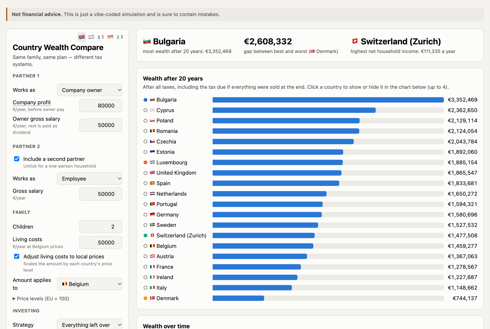

# Country Wealth Compare

Where in Europe would your family build the most wealth? This tool takes one household, with the same income and the same savings plan, and shows what is left after tax in 20 European countries, today and after years of investing.

**[Open the tool](https://fbl.github.io/country-compare/)** — nothing to install, and your numbers never leave your browser.

Available in English, Nederlands, Français, Deutsch and Italiano: click a flag at the top of the form.

## How to use it

1. **Describe your household.** For each partner, choose "Company owner" or "Employee" and fill in the income. Add children and what you spend per year.
2. **Describe your savings plan.** Invest everything that is left over, or a fixed amount per month, in a global stock fund (ETF). Set the expected yearly return and the number of years.
3. **Read the results.** The countries are ranked by wealth at the end, after all taxes. Click a country to add it to the chart.

Every change updates the results straight away. "Reset to defaults" puts everything back.

## What you get

- **Ranking:** wealth after tax in each country at the end of your horizon.
- **Chart:** how that wealth grows year by year, for up to four countries.
- **Yearly breakdown:** where the money goes in each country: social contributions, income tax, dividend tax, child benefit and living costs.
- **Side by side:** two countries compared step by step, from gross income to final wealth.
- **Assumptions:** what each country's model includes and leaves out.

## A few terms

- **Company profit:** what the company invoices minus its business costs, before the owner is paid anything. It is not turnover.
- **Owner salary:** the part of that profit the owner takes as salary. The rest is taxed as company profit and paid out as dividend.
- **ETF:** a low-cost fund that follows the whole stock market.
- **Living costs:** entered at the prices of one country and scaled to each country's price level, so the same lifestyle costs less in Sofia than in Zurich.

Hover over a field with a dotted underline for a longer explanation.

## Good to know

- **Estimates, not tax advice.** The models are simplified versions of 2026 tax rules. Use the tool to shortlist countries, then check with a local tax adviser before deciding anything.
- **It assumes you live in the country.** Moving costs, exit taxes and housing in expensive cities are not included.
- **Belgium has extra options** for company owners: reduced dividend rate, copyright royalties, company pension and investing inside the company. Other countries do not have these yet.

## Use it offline

Download [country-compare.html](country-compare.html). It is the whole tool in one file and works without an internet connection.

## For developers

No dependencies and no build step for normal use: open [index.html](index.html) in a browser.

| File | What it holds |
|---|---|
| `index.html` | The page and its interface |
| `taxdata.js` | The tax model for each country |
| `lang/` | Interface text and country notes, one file per language |
| `engine.js` | The household and investment calculation |
| `check.js` | A command-line sanity check: `node check.js` |
| `build.js` | Packs everything into `country-compare.html`: `node build.js` |
